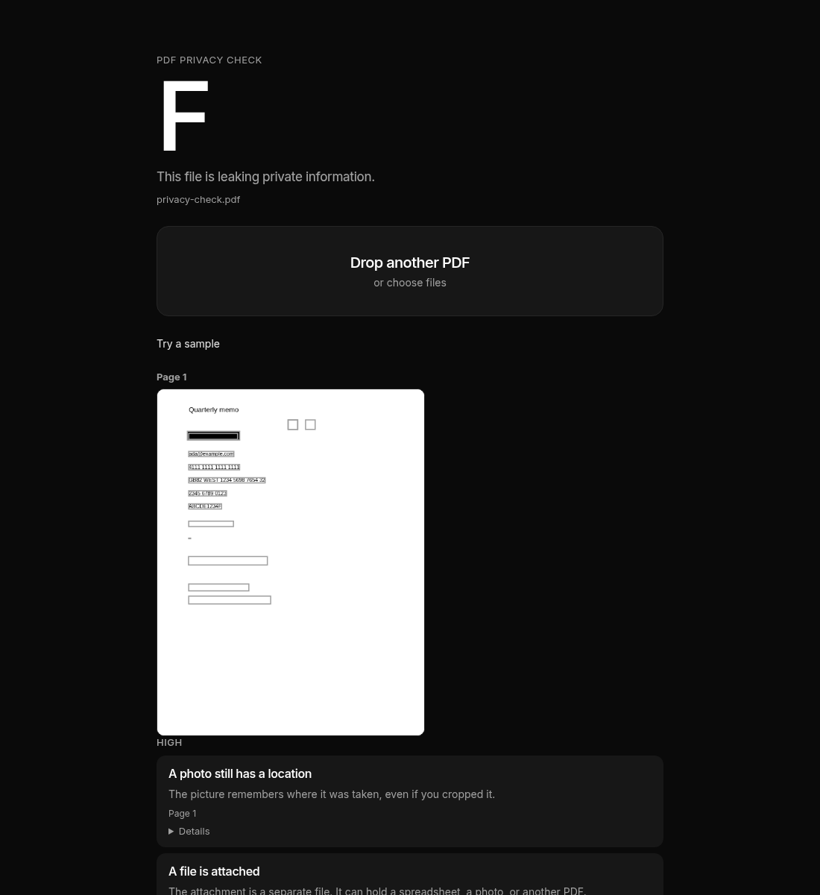

# PDF Privacy Check

Find what your PDF is secretly leaking. Black boxes, hidden text, old saves, and file info can still be in the file. Drop a PDF, read the score, and download a cleaner copy.

Live: https://gfxroy.github.io/redaction-audit/



The check runs in the browser. Nothing is uploaded.

## Features

- Fake redactions: text under a black box, a white box, or a markup annotation.
- White text, invisible text, text outside the page, and type smaller than 2pt.
- Author, title, and other file info, including XMP.
- Attached files and file-attachment annotations.
- Comments and highlights.
- Form answers.
- Scripts and actions, and links to other websites.
- An earlier save still sitting at the start of the file, with a download of that copy.
- Layers, including hidden ones.
- GPS and camera details in embedded JPEG photos.
- Emails, phone numbers, card numbers, IBANs, Aadhaar numbers, PANs, Social Security numbers, and API keys.
- Signer name and date on a digital signature.
- A privacy score from A to F, with a short sentence.
- Page thumbnails with the problem areas outlined.
- Clean & download: burn boxes into the page, strip file info, remove attachments, scripts, and comments, and clear form answers. The cleaned file is checked again, and the score is shown before and after.
- Several PDFs at once, with a score for each and one download of the cleaned copies.

Try a sample loads a file that trips these checks.

## How it works

pdf.js reads the file locally. A worker, the cmap files, and the standard fonts are bundled with the site.

Filled rectangles come from the page's operator list. The walker keeps a graphics-state stack: `q`/`Q`, the current transformation matrix, and the fill color in gray, RGB, or CMYK. pdf.js 5 reports a path as one `constructPath` whose first argument is the paint operator and whose coordinates are still in user space, so the current matrix is applied here. A fill is kept when its luminance is under 0.2 and its area is at least 16 square points. Luminance is `0.2126 R + 0.7152 G + 0.0722 B`. A fill at or above 0.9 is a whiteout. Strokes, marks thinner than 2 points, and fills with opacity under 0.5 are ignored. The same walk records each `showText`, so a box counts only when it is painted after the text. Text color, text rendering mode, and the effective font size come from that walk too. White text is a luminance at or above 0.9. Rendering mode 3 is invisible. Type is tiny when the effective size is under 2pt. A run is off the page when its box sits fully outside the page.

Text comes from `getTextContent`. Each item is split into one box per character, sharing the item's width equally. The box sits on the baseline, 80% of the font size above it and 20% below. A character leaks when a later dark or white fill covers more than half of that box. Square and highlight annotations count when they are black. A redaction annotation with no burned-in appearance counts at any overlap. One character is reported once, under the topmost cover. pdf.js sometimes glues adjacent `showText` runs into one item. That item is placed at the first run's position in the stream.

The rest of the check reads the PDF objects with pdf-lib. File info is the Info dictionary and the catalog XMP stream. Attachments are the EmbeddedFiles name tree and file-attachment annotations. Scripts are JavaScript name-tree entries, OpenAction, and additional-actions dictionaries. Form answers are AcroForm field values. Signatures are signature dictionaries reached from the form. Layers are optional-content groups, hidden when they are in the default OFF list or marked view-off. JPEG photos are DCTDecode image streams; the GPS block is the Exif APP1 segment. An earlier save is a second `startxref` / `%%EOF`. The bytes up to the first `%%EOF` are offered as a download.

Personal details are matched in the extracted text, comments, form answers, scripts, and text attachments. Card numbers have to pass the Luhn check. IBANs have to pass the mod-97 check.

The score is A when nothing is found, B for small traces only, C when something medium is present, D for one serious finding, and F for more than one.

Clean rebuilds the file. A page with a cover is drawn at 200 DPI and the covers are painted into the pixels, which also drops hidden text on that page. Pages with no covers are copied as vectors. File info, attachments, scripts, comments, and form answers are removed when those switches are on. Saving a new file drops earlier versions. The cleaned bytes are opened and scored again.

Several cleaned files are packed in a ZIP that stores them without compression, because a browser will not reliably save many downloads from one click.

## Limitations

- A black bar that is only an image is not detected. The walker looks at filled paths and at Square, Highlight, and Redact annotations.
- Opacity under 0.5 is ignored. Clipping paths and holes in even-odd fills are ignored.
- Glyph boxes split a run's width equally. On a proportional font the boxes are a little wider or narrower than the real glyphs.
- Colors with luminance from 0.2 up to 0.9 are ignored. A gray box in that range is not treated as a cover.
- White text drawn on top of a dark box is treated as visible, because it shows against the box.
- Encrypted PDFs are refused. Remove the password first.
- Rasterizing a page replaces its whole text layer with a 200 DPI image. Text on that page cannot be selected afterward, and small type can look soft. A joined text item uses the first run's paint order, so a box drawn between two runs that pdf.js merged can be blamed for characters that were painted later.
- Any clean that writes a new file drops incremental history, even if you only asked to remove the author. Turning every switch off returns the original bytes.
- Burning a page does not copy layers or signatures back onto that page. Clearing form answers also removes a signature field.
- Camera details are read from JPEG photos embedded as DCTDecode images. Other image formats are skipped.
- The personal-detail check looks for common patterns. It misses numbers written out in words, and it can flag a lookalike.
- The whole file is held in memory in the tab. A very large PDF can run the browser out of memory.

## Development

```bash
npm install
npm test
npm run dev
npm run build
```

`npm run build:pages` builds with the GitHub Pages base path `/redaction-audit/`.

The sample files live in `public/samples/`. `src/lib/samples.ts` builds them.
